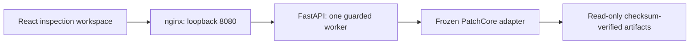

# Fieldwork — Industrial anomaly detection

Research and an inspection application for detecting unusual industrial images and locating model responses. This project compares **six CNN-based methods across all 15 original MVTec AD categories and three seeds (270 evaluations)**, then serves a frozen simplified PatchCore model through a Python adapter, FastAPI, React/TypeScript and CPU/CUDA containers.

> **Research use only.** Raw anomaly distances are not probabilities, and an anomaly decision is not a verified manufacturing defect. False alarms and missed defects remain possible.


This actual running-interface capture uses an original procedural fixture and a genuine backend response. It contains no MVTec pixels and is not an accuracy demonstration. [Mobile capture](docs/images/inspection-dashboard-mobile.png).

[Research results](#main-research-results) · [Architecture](#architecture) · [Quick start](#quick-start) · [Documentation](docs/index.md) · [Project overview](docs/project_overview.md)

## What the project does

- Compares scratch baselines and pretrained representations through eight documented notebooks, bounded experiments and frozen all-category evaluations.
- Separates image detection, pixel localization and calibrated operating-point metrics, with category-level and paired statistical analysis.
- Provides an inspection workspace with model/category discovery, PNG/JPEG upload, original/heatmap/overlay comparison, zoom, raw score, threshold, provenance and timing.
- Reuses the exact selected PatchCore artifacts: seed 2026, frozen ResNet18, 2,048-vector banks and original normal-calibration thresholds. Only PatchCore is implemented in the application.
- Packages a loopback-only nginx frontend and private, guarded FastAPI worker. Uploaded images and ephemeral visualizations are not persisted as inspection history.

## Main research results

Category means average three seeds; macro means give all 15 categories equal weight. The methods have documented differences in fitting, preprocessing and image aggregation. Several are simplified or reduced-budget variants rather than paper-equivalent implementations.

| Model | Image AUROC | Image AP | Pixel AUROC | Pixel AP | AU-PRO | Recall | FPR | Precision | F1 |
|---|---:|---:|---:|---:|---:|---:|---:|---:|---:|
| Basic CNN | 0.7126 | 0.8590 | 0.7858 | 0.2354 | 0.5498 | 0.4018 | 0.0983 | 0.8733 | 0.5106 |
| Convolutional AE | 0.6346 | 0.8279 | 0.6900 | 0.1109 | 0.4494 | 0.2350 | 0.0939 | 0.7896 | 0.3146 |
| Simplified PatchCore | 0.9676 | 0.9885 | 0.9729 | 0.5402 | 0.9204 | 0.8904 | 0.1718 | 0.9400 | 0.9043 |
| SuperSimpleNet Lite | 0.9648 | 0.9862 | 0.9528 | 0.4361 | 0.8565 | 0.8920 | 0.1662 | 0.9412 | 0.9099 |
| PaDiM | 0.8979 | 0.9464 | 0.9659 | 0.4538 | 0.9119 | 0.6965 | 0.1445 | 0.9255 | 0.7554 |
| EfficientAD-S reduced-budget | 0.8163 | 0.9186 | 0.9199 | 0.4985 | 0.8184 | 0.6656 | 0.2201 | 0.8859 | 0.7401 |

Values are fractions rounded to four decimals from the [unchanged canonical table](reports/final_comparison/model_macro.csv); lower FPR is preferable. The [full research report](reports/final_comparison/report.md) contains all nine metrics, per-category findings, paired uncertainty and protocol differences. Small macro differences do not establish universal superiority.

Pretrained methods performed more strongly than scratch baselines in this benchmark. PatchCore was selected for its balance of image detection, localization, fitting effort and traceability. SuperSimpleNet Lite is a competitive alternative with a different speed/localization tradeoff. PaDiM localized well despite weaker image detection. Reduced-budget EfficientAD results do not represent full-budget EfficientAD.

**Calibration is a practical limitation:** PatchCore's recorded category-macro test FPR was about **17.2%**, despite a nominal 5% normal-calibration target. Small calibration sets, distribution changes and category-specific score behavior limit transfer. The deployed seed is fixed independently of test performance; thresholds were not tuned retrospectively. These MVTec observations do not establish generalization to a new factory.

## Architecture



The adapter preserves whole-image preprocessing, ResNet18 layer2/layer3 features, nearest-neighbor scoring and top-1% image aggregation. Lazy loading keeps two category models in an LRU cache; concurrent inference is bounded. Heatmap display scaling is separate from raw scores and calibration. See the [inference](docs/patchcore_inference.md), [API](docs/backend_api.md), [frontend](docs/frontend_guide.md) and [deployment](docs/deployment_guide.md) guides.

## Quick start

### Inspect and build without model assets

A fresh clone supports frontend checks with Node **26.13.0** / npm **11.20.0**. From the repository root in PowerShell:

```powershell
npm.cmd --prefix frontend ci
npm.cmd --prefix frontend run typecheck
npm.cmd --prefix frontend run lint
npm.cmd --prefix frontend test
npm.cmd --prefix frontend run build
```

No existing Python environment or model download is assumed. [Asset-free Python checks](docs/reproducibility.md#b-build-source-and-run-checks-without-model-assets) use a clean public-source copy and CPU container, or the read-only [Source quality workflow](.github/workflows/source-quality.yml). Source checks do not claim real-model accuracy or deployment verification.

### Run with retained release artifacts

Serving requires legitimate, byte-identical retained extractor/bank/calibration files. Restore the 33 manifest-listed files under `outputs/deployment/artifacts/` first; they are **not distributed here**. With Docker/Compose running:

```powershell
docker compose -p fieldwork-public --env-file deployment/.env.example build
docker compose -p fieldwork-public --env-file deployment/.env.example run --rm --no-deps --entrypoint python backend -m deployment.artifacts --root /artifacts
docker compose -p fieldwork-public --env-file deployment/.env.example up -d --wait --wait-timeout 180
```

Open **http://127.0.0.1:8080**. CPU is the default; the backend has no published host port. To stop this project:

```powershell
docker compose -p fieldwork-public --env-file deployment/.env.example down --timeout 30
```

## Reproducibility and artifact limits

The [reproducibility guide](docs/reproducibility.md) separates three paths: running with retained artifacts, source/tests without assets, and reproducing research from legitimate dataset/weight sources. A fresh clone contains no original `.venv`, MVTec images, weights, banks or large caches. No public download or retraining procedure is promised to recreate checksum-identical serialized artifacts. Original research locks include Windows/CUDA assumptions and are not portable CPU installers.

No public CI job trains models, recalibrates thresholds, runs the 270 evaluations or accesses private artifacts. The research and deployment reports remain immutable. Historical publication scripts are archival tools, not commands to regenerate the current portfolio README or replace evidence.

## Notebooks and repository map

| Notebook | Research story |
|---|---|
| [00](notebooks/00_dataset_eda.ipynb) | Dataset integrity and exploratory analysis |
| [01](notebooks/01_basic_cnn.ipynb) | Basic CNN baseline |
| [02](notebooks/02_convolutional_autoencoder.ipynb) | Reconstruction baseline |
| [03](notebooks/03_patchcore.ipynb) | Simplified PatchCore |
| [04](notebooks/04_supersimplenet.ipynb) | SuperSimpleNet Lite |
| [05](notebooks/05_padim.ipynb) | PaDiM |
| [06](notebooks/06_efficientad.ipynb) | EfficientAD-S reduced-budget |
| [07](notebooks/07_model_comparison.ipynb) | Final six-model research comparison |

- `src/anomaly_detection/`: reusable research, inference and backend modules.
- `frontend/`: pinned React/TypeScript/Vite application and unit tests.
- `deployment/`, `compose*.yaml`: pinned containers, private routing and artifact preflight.
- `configs/`, `experiments/`, `reports/`: frozen policies, append-only history and compact evidence.
- `tests/`, `scripts/`: focused tests, validators, bounded benchmarks and recovery tooling.
- `docs/`: [inference](docs/patchcore_inference.md), [API](docs/backend_api.md), [frontend](docs/frontend_guide.md), [deployment](docs/deployment_guide.md) and [milestone status](docs/milestone_status.md).

Raw MVTec images, model weights/banks, large maps, caches, environment secrets and build outputs stay outside Git and public container images. Detailed local measurements and any licensed screenshots remain under ignored outputs.

## Testing and deployment evidence

The retained [Milestone 13 results](reports/deployment/results.md) record **220 Python tests, 39 frontend unit tests and three production-browser tests**, plus typecheck/lint/build, real CPU/CUDA inference across all 15 categories, object/texture dashboard flows, artifact parity, bounded concurrency, expiry and crash recovery. These are historical measurements, not newly rerun inference in this portfolio audit.

| Device/category | Tensor model p50/p95 ms | HTTP p50/p95 ms |
|---|---:|---:|
| CPU/bottle | 26.88 / 29.68 | 58.64 / 69.47 |
| CPU/carpet | 26.17 / 30.66 | 85.55 / 89.67 |
| CUDA/bottle | 4.84 / 7.16 | 56.29 / 59.79 |
| CUDA/carpet | 4.88 / 5.58 | 69.71 / 88.73 |

Five warmups and 30 samples per category. Tensor computation, backend/HTTP, visualization and browser timings have different boundaries; they are not interchangeable speed claims. Full hardware, memory, image sizes and methodology are in the linked report.

The separate [portfolio audit](reports/portfolio/audit.md) records current source-check results, fresh-clone scope and remaining blockers. A locally tested workflow is not labeled a successful remote CI run without checking GitHub's actual run.

## Licensing, attribution and limitations

**No project-wide source license is currently declared.** Public source availability does not establish unrestricted reuse permission. MVTec AD is distributed by its authors under CC BY-NC-SA 4.0. Pretrained weights and dataset-derived models need separate rights review; the unofficial EfficientAD teacher's separate weight license remains unconfirmed. No datasets, weights or banks are published. See the [licensing and attribution review](docs/licensing_and_attribution.md).

Primary methods, variants and references are documented in the notebooks and [final research report](reports/final_comparison/report.md). The work builds on MVTec AD, ImageNet/torchvision, PatchCore, SuperSimpleNet, PaDiM and EfficientAD, with retained upstream notices and acknowledgments.

This is a local research prototype. Known Python findings and the development-tool picomatch advisory remain disclosed; a clear production npm audit does not clear the whole system. Image-CVE scanning remains unverified because Docker Scout required authentication. There is no production security, availability or industrial calibration guarantee. Read [SECURITY.md](SECURITY.md) before considering external deployment.
