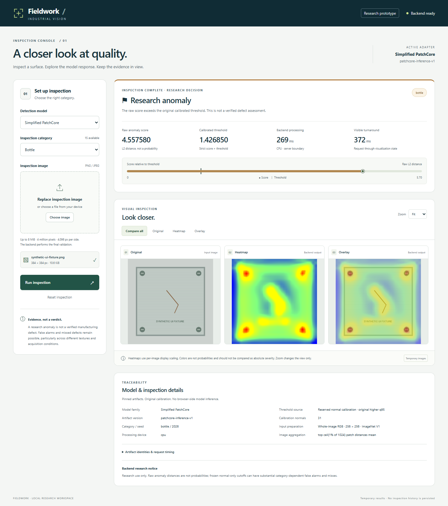
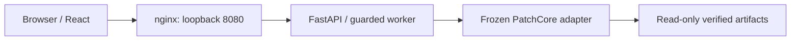

# Fieldwork · Industrial visual anomaly inspection

A reproducible MVTec AD research project and local inspection application: **eight notebooks, six architectures, 15 categories, three seeds and 270 final evaluations**. Frozen simplified PatchCore powers a reusable CPU/CUDA inference adapter, FastAPI backend and responsive React dashboard.

> Research use only. An anomaly distance is not a probability, and an anomaly decision is not a verified manufacturing defect. This release is not approved for unauthenticated public deployment.



The screenshot contains an original procedural fixture and its genuine backend response, with no MVTec pixels. It illustrates the UI, not model accuracy. [Mobile view](docs/images/inspection-dashboard-mobile.png).

## Run the packaged application

Prerequisites: running Docker Desktop/WSL2 or a compatible Linux Docker host, the existing project `.venv`, and legitimately retained byte-identical model artifacts. Weights, banks and dataset images are intentionally not included. From the repository root in PowerShell:

```powershell
.\.venv\Scripts\python.exe -m deployment.artifacts --root . --export outputs/deployment/artifacts
.\.venv\Scripts\python.exe scripts/release_deployment.py build
.\.venv\Scripts\python.exe scripts/release_deployment.py up
```

Open **http://127.0.0.1:8080**. CPU is the portable default. See the [deployment guide](docs/deployment_guide.md) for artifact restoration, environment settings, verified commands, CUDA status, health checks, tests and shutdown. The backend has no published host port; only nginx binds loopback.



## Inspection features

- Actual model/category discovery; PatchCore supports all 15 original MVTec categories.
- PNG/JPEG drag/drop, preview and server-authoritative size/format checks: 8 MiB, four million pixels, 4,096 per side.
- Raw score, original threshold and strict research decision; provenance, device, preprocessing and latency.
- Original/heatmap/overlay comparison, zoom, keyboard controls, responsive layouts, reset and clear failure states.
- Lazy two-category cache, guarded inference and ephemeral visualizations. No browser inference or persisted inspection history.

## Research methodology and findings

Normal-only fitting/development/calibration partitions are disjoint from official test evaluation. Category means average three seeds; macro means weight all 15 categories equally. Frozen selection/calibration policies and exact historical metric values are preserved. All scores increase with anomaly; cutoffs use strict comparisons. Simplified and reduced-budget architectures are labeled explicitly.

| Model | Image AUROC | Image AP | Pixel AUROC | Pixel AP | AU-PRO | Recall | FPR | Precision | F1 |
|---|---:|---:|---:|---:|---:|---:|---:|---:|---:|
| Basic CNN | 0.7126 | 0.8590 | 0.7858 | 0.2354 | 0.5498 | 0.4018 | 0.0983 | 0.8733 | 0.5106 |
| Convolutional AE | 0.6346 | 0.8279 | 0.6900 | 0.1109 | 0.4494 | 0.2350 | 0.0939 | 0.7896 | 0.3146 |
| Simplified PatchCore | 0.9676 | 0.9885 | 0.9729 | 0.5402 | 0.9204 | 0.8904 | 0.1718 | 0.9400 | 0.9043 |
| SuperSimpleNet Lite | 0.9648 | 0.9862 | 0.9528 | 0.4361 | 0.8565 | 0.8920 | 0.1662 | 0.9412 | 0.9099 |
| PaDiM | 0.8979 | 0.9464 | 0.9659 | 0.4538 | 0.9119 | 0.6965 | 0.1445 | 0.9255 | 0.7554 |
| EfficientAD-S reduced-budget | 0.8163 | 0.9186 | 0.9199 | 0.4985 | 0.8184 | 0.6656 | 0.2201 | 0.8859 | 0.7401 |

Values are fractions rounded to four decimals from [the canonical macro table](reports/final_comparison/model_macro.csv). [The full research report](reports/final_comparison/report.md) documents protocol differences, category/seed uncertainty and paired comparisons. Small macro differences do not establish universal superiority.

Pretrained methods performed more strongly than the scratch baselines in this benchmark. PatchCore balances image ranking and localization; SuperSimpleNet Lite offers a competitive faster alternative, and PaDiM localizes well despite weaker image detection. The reduced-budget EfficientAD result does not represent full paper-length EfficientAD. These observations are not causal proof or a guarantee beyond MVTec.

Threshold transfer remains a key limitation: PatchCore macro test FPR is about 17.2% despite a nominal 5% normal-calibration target. Fine defects, screw image detection, texture false alarms and broad localization responses remain documented failure modes. No deployment recalibration or test-driven tuning was performed.

## Verified engineering and benchmarks

The release verification includes **220 Python tests, 39 frontend unit tests and 3 production-browser tests**, with zero failures/skips in final runs. Typecheck, lint, build, artifact identities, all-category parity and research protection passed. CPU container inference and real object/texture dashboard flows are verified.

| Device/category | Tensor model p50/p95 ms | HTTP p50/p95 ms |
|---|---:|---:|
| cpu/bottle | 26.88 / 29.68 | 58.64 / 69.47 |
| cpu/carpet | 26.17 / 30.66 | 85.55 / 89.67 |
| cuda/bottle | 4.84 / 7.16 | 56.29 / 59.79 |
| cuda/carpet | 4.88 / 5.58 | 69.71 / 88.73 |

Five warmups and 30 samples per category; model and HTTP boundaries differ. These Linux-container measurements are not directly interchangeable with earlier Windows, model-only GPU or browser timings. [Complete release evidence](reports/deployment/results.md) includes memory, startup, visualization, browser, reliability and GPU outcomes.

Known security findings remain in frozen-compatible Python dependencies and the development toolchain. Production React dependencies audit clear. Docker Scout image-CVE scanning is blocked by required authentication. This is a bounded local research release, not a claim of production security or availability.

## Notebooks and repository map

| Notebook | Research story |
|---|---|
| [00](notebooks/00_dataset_eda.ipynb) | Dataset integrity and exploratory analysis |
| [01](notebooks/01_basic_cnn.ipynb) | Basic CNN baseline |
| [02](notebooks/02_convolutional_autoencoder.ipynb) | Reconstruction baseline |
| [03](notebooks/03_patchcore.ipynb) | Simplified PatchCore |
| [04](notebooks/04_supersimplenet.ipynb) | SuperSimpleNet Lite |
| [05](notebooks/05_padim.ipynb) | PaDiM |
| [06](notebooks/06_efficientad.ipynb) | EfficientAD-S reduced-budget |
| [07](notebooks/07_model_comparison.ipynb) | Final six-model research comparison |

- `src/anomaly_detection/`: reusable research, inference and backend modules.
- `frontend/`: pinned React/TypeScript/Vite application and unit tests.
- `deployment/`, `compose*.yaml`: pinned containers, private routing and artifact preflight.
- `configs/`, `experiments/`, `reports/`: frozen policies, append-only history and compact evidence.
- `tests/`, `scripts/`: focused tests, validators, bounded benchmarks and recovery tooling.
- `docs/`: [inference](docs/patchcore_inference.md), [API](docs/backend_api.md), [frontend](docs/frontend_guide.md), [deployment](docs/deployment_guide.md) and [milestone status](docs/milestone_status.md).

Raw MVTec images, model weights/banks, large maps, caches, environment secrets and build outputs stay outside Git and public container images. Detailed local measurements and any licensed screenshots remain under ignored outputs.

## Local development and verification

The existing CUDA Python environment is preserved. In separate PowerShell terminals:

```powershell
$env:ANOMALY_DEVICE = 'cpu'
.\.venv\Scripts\python.exe -m uvicorn anomaly_detection.backend.app:app --host 127.0.0.1 --port 8000 --workers 1 --no-access-log
# Second terminal: Node 26.13.0 / npm 11.20.0
npm.cmd --prefix frontend ci
npm.cmd --prefix frontend run dev
```

Development UI: http://127.0.0.1:5173; backend OpenAPI: http://127.0.0.1:8000/docs. Deployment uses compiled nginx assets on port 8080 instead.

```powershell
.\.venv\Scripts\python.exe -m pytest -q --basetemp=.pytest-tmp-release
npm.cmd --prefix frontend run typecheck
npm.cmd --prefix frontend run lint
npm.cmd --prefix frontend test
npm.cmd --prefix frontend run build
```

See the deployment guide for real-model integration, source protection, audit and benchmark commands. Do not retrain models to run the application.

## References and rights

Research builds on MVTec AD, ImageNet/torchvision representations, PatchCore, PaDiM, SuperSimpleNet and EfficientAD; primary references and variant differences are documented in the notebooks and [final report](reports/final_comparison/report.md). Thanks to the dataset authors and open-source PyTorch, FastAPI, React, Vite, nginx and Docker communities.

Review each dataset, pretrained weight, dependency and tool license before redistribution or commercial use. This repository does not invent a grant for MVTec images or ImageNet-derived weights, and no project-wide redistribution license is asserted here. See [weight provenance and reproduction](docs/patchcore_reproduction.md). No public release tag or Docker-registry publication was created.
