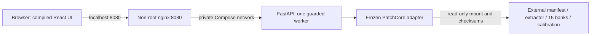

# Deployment and final-release guide

Fieldwork packages the frozen simplified PatchCore inspection system. It is a
local research prototype with no authentication, TLS termination or production
availability guarantee. Do not publish the unauthenticated API on the internet.



Only nginx publishes a port, bound to `127.0.0.1`. The backend has no host port
and belongs only to the internal inspection network. nginx also joins an edge
network so Docker can publish its loopback port. Static assets and same-origin
`/api`/`/health` routing use no development URLs. Docker DNS re-resolution allows
backend replacement; SPA fallback permits browser refresh. Backend errors and
ephemeral PNGs follow the unchanged API contract.

## Requirements and supported scope

- Docker Engine with Compose supporting health dependencies and resource limits.
- Linux amd64 containers. This release is tested on Windows Docker Desktop/WSL2;
  the configuration is intended for Linux Docker hosts but is not a cross-platform
  certification. Other CPU architectures have not been verified.
- The existing Python 3.12 project `.venv` for artifact/export/test tooling.
- Node 26.13.0/npm 11.20.0 for local frontend development and browser tests;
  container builds supply the pinned Node stage independently.
- Legitimately retained local release artifacts; no training dataset is needed
  for serving. Real-image validation additionally needs locally licensed MVTec data.
- See [release measurements](../reports/deployment/results.md) for observed sizes,
  memory and timing. Default limits: backend four CPUs/3 GiB, frontend one CPU/
  128 MiB; CUDA override gives backend 5 GiB. These are limits, not minimum-memory
  guarantees. The verified machine provides a 24-CPU/approximately 15.5-GiB Docker VM.

On Windows, enable hardware virtualization and install Docker Desktop with its
WSL2 Linux-container backend. Start Docker Desktop before use. This session found
Docker initially stopped; `docker desktop start` recovered it without changing the
project's CUDA Python environment. Check:

```powershell
docker version
docker compose version
wsl --status
```

Docker Desktop installation/license terms are separate from this project. Setup
of a new host, BIOS or WSL distribution is not performed automatically.

## Artifact setup: exact identities, no refitting

From the repository root in PowerShell:

```powershell
.\.venv\Scripts\python.exe -m deployment.artifacts --root .
.\.venv\Scripts\python.exe -m deployment.artifacts --root . --export outputs/deployment/artifacts
```

Both commands were run on the retained artifacts. Export copies only 33 required
files, approximately 59.1 MB, preserving bytes and relative paths. It is resumable:
matching files are reused, conflicting files are refused. No raw images, test
predictions or training caches are included. All 15 categories are validated.

The trust root is the Git-controlled manifest SHA-256:
`58be2eafb16ac012ac18e0feb69f11b2f510e7417464eaba5bd9797b423272fa`.
The exporter and container entrypoint verify the manifest, extractor, frozen
configuration, all 15 banks, calibration records and original thresholds. The
inference adapter repeats category-specific identity/shape/provenance checks on
load. Checksums verify identity relative to this trusted release; they are not
an authenticity signature for arbitrary downloaded files.

Policy remains frozen ResNet18 ImageNet V1 layer2/layer3 features, seed 2026,
2,048 x 384 FP32 bank vectors per category, whole-image 256-square preprocessing,
top-1% mean raw patch distances and original strict normal-calibration cutoffs.
No model training, coreset fitting or recalibration is part of deployment.

If missing, restore byte-identical retained artifacts using the manifest paths
and legitimate acquisition history in [the reproduction guide](patchcore_reproduction.md).
Re-serializing a bank is not guaranteed to preserve its checksum. The deployment
helper does not download weights or a pretraining dataset. Model/data licensing
must be reviewed for any redistribution or commercial deployment. Torchvision
code licensing does not by itself grant unrestricted rights to ImageNet-derived
weights or the MVTec dataset. See [inference provenance](patchcore_inference.md).

## CPU Compose launch

```powershell
docker compose -p fieldwork-m13 --env-file deployment/.env.example config --quiet
.\.venv\Scripts\python.exe scripts/release_deployment.py build
.\.venv\Scripts\python.exe scripts/release_deployment.py up
```

The helper runs the same pinned Compose project, builds local images without
publishing them, records timings/identities and waits for health. Completed builds
are reused when their source fingerprint and local image ID agree. Detailed build
logs stay under ignored `outputs/deployment`. To use Compose directly:

```powershell
docker compose -p fieldwork-m13 --env-file deployment/.env.example up -d --build --wait --wait-timeout 180
docker compose -p fieldwork-m13 ps
Invoke-RestMethod http://127.0.0.1:8080/health/live
Invoke-RestMethod http://127.0.0.1:8080/health/ready
```

Open **http://127.0.0.1:8080**. `deployment/.env.example` has no secrets or private
machine paths. To customize, create an ignored `.env` and pass its filename with
`--env-file`; configure `ARTIFACT_DIR`, `FRONTEND_PORT`, and `CPU_THREADS`. Keep
the artifact directory read-only and preserve the pinned checksum. The helper
uses the committed example file; use direct Compose for a customized environment.

Select PatchCore and the actual image category, upload PNG/JPEG and inspect
original, heatmap and overlay. Limits remain 8 MiB, four million decoded pixels
and 4,096 per side; nginx additionally bounds the complete multipart request to
9 MiB. Raw distances are not probabilities. The original threshold is a research
operating point, not a manufacturing quality guarantee. Reset and repeat without
storing inspection history. PNG URLs expire/evict/restart; browser blobs may last
until reset or page closure.

## CUDA: explicit opt-in

GPU deployment requires a compatible NVIDIA GPU, Windows driver/WSL2 GPU support,
Docker Desktop Linux GPU pass-through or a Linux NVIDIA Container Toolkit setup,
and enough disk/RAM/VRAM for the CUDA image and two-category cache. CPU remains the
default. No automatic fallback conceals CUDA failure.

```powershell
docker run --rm --gpus all nvidia/cuda:12.8.1-base-ubuntu24.04 nvidia-smi
.\.venv\Scripts\python.exe scripts/release_deployment.py build --service backend --cuda
.\.venv\Scripts\python.exe scripts/release_deployment.py up --cuda
docker compose -p fieldwork-m13 --env-file deployment/.env.example -f compose.yaml -f compose.cuda.yaml exec -T backend python -c "import torch; print(torch.__version__, torch.cuda.is_available(), torch.cuda.get_device_name(0))"
```

The separate override requests GPU access and `ANOMALY_DEVICE=cuda`; it uses the
digest-pinned official PyTorch 2.11.0/CUDA 12.8 runtime and matching torchvision
0.26.0 cu128 wheel. Build assertions enforce Python 3.12 and the requested CUDA
build. Direct installation of the 657.9-MB cuDNN wheel timed out twice; the
official runtime is the bounded alternative acquisition route. Its digest fixes
the bundled CUDA libraries; requirements-cuda-runtime.txt retains the original
wheel metadata for provenance, not a claim that every installed base package
equals that alternative lock.
The CPU runtime uses Python 3.12.16; the official GPU base uses Python 3.12.3.
Application pins are isolated in a container venv that reuses the base's exact
torch runtime. Its unused `spin` build helper was removed to resolve a Click
constraint conflict; the host Python environment was not changed. The inherited
GPU base is large and its older Python/additional packages require security
review before any public deployment.
The CPU image uses explicit `+cpu` wheels. The base Python/Node/nginx images are
pinned by tags and immutable index digests. GPU probe and application outcomes are
recorded separately in the release results: do not equate host CUDA, nvidia-smi
inside a container and a successful containerized model prediction.

Returning to CPU uses `release_deployment.py up` without `--cuda`, which recreates
the category service with the CPU image. No host PyTorch installation is changed.

## Local non-container launch

The existing verified development path remains available in two terminals:

```powershell
$env:ANOMALY_DEVICE = 'cpu'
.\.venv\Scripts\python.exe -m uvicorn anomaly_detection.backend.app:app --host 127.0.0.1 --port 8000 --workers 1 --no-access-log
```

```powershell
npm.cmd --prefix frontend ci
npm.cmd --prefix frontend run dev
```

Open port 5173 for this development route. It is distinct from the compiled nginx
distribution on 8080; timing boundaries are not interchangeable. Refer to the
[frontend](frontend_guide.md) and [backend](backend_api.md) guides for local settings.

## Tests and bounded benchmarks

```powershell
.\.venv\Scripts\python.exe -m pytest -q --basetemp=.pytest-tmp-release --junitxml=outputs/deployment/pytest.xml
npm.cmd --prefix frontend run typecheck
npm.cmd --prefix frontend run lint
npm.cmd --prefix frontend test -- --reporter=json --outputFile=../outputs/deployment/frontend-tests.json
npm.cmd --prefix frontend run build
.\.venv\Scripts\python.exe scripts/benchmark_release.py --device cpu
.\.venv\Scripts\python.exe scripts/release_deployment.py browser
```

Use `--device cuda` only while the CUDA Compose variant is running. The benchmark
uses five warmups and 30 serial measured requests per object/texture category,
five visual requests and ten PNG retrievals, 30 tensor-path samples after five
warmups, all-category parity and a four-request concurrency burst. No public
service is stressed. The code was predetermined; official labels never select a
model policy. Detailed timings and scopes are in the report. Existing final
measurement files are refused to prevent accidental reruns; interrupted category
measurements are retained under `outputs/deployment` for recovery. Do not run
builds, regression suites or other GPU workloads during measured phases.

For an independent benchmark recheck after cloning a published release, preserve
the committed evidence and select a fresh ignored output directory:

```powershell
.\.venv\Scripts\python.exe scripts/benchmark_release.py --device cpu --output-dir outputs/deployment/recheck
```

This optional destination is supported by the same measured protocol; do not
replace the published report with a later run or merge measurements across devices.

Browser checks require installed Edge and the frontend's pinned Playwright tools.
The runner reads genuine samples locally without republishing pixels. It tests
the compiled assets, discovery, scores/thresholds, PNGs, reset/repeat, refresh and
connection recovery. Request cancellation cannot terminate already running
backend inference. Reliability checks cover only bounded local operation, not
production uptime or long-duration leak freedom.

## Security, shutdown and troubleshooting

Both services run non-root with read-only roots, dropped capabilities, restricted
PID/memory/CPU limits, tmpfs temporary storage and `no-new-privileges`. Backend
uploads remain memory-backed. No weights, banks, data, reports, Git metadata or
credentials enter the deny-by-default build context. No persistent result volume
is needed. nginx adds framing/content-type/referrer/CSP headers; inline style
permission supports React's zoom styles, not arbitrary inline scripts. CORS is
not broadened because the browser uses the same-origin proxy.

```powershell
docker compose -p fieldwork-m13 logs --tail 80 backend frontend
.\.venv\Scripts\python.exe scripts/release_deployment.py down
```

Graceful shutdown is bounded and preserves the external artifacts. The runtime
execs a single uvicorn process under Compose's init wrapper. Restart policy is
limited to three failures; health status alone does not guarantee automatic
restart, and health-dependency ordering applies at startup. A default-category
readiness success does not promise every future image/device operation succeeds.

For missing artifacts, rerun the validator and inspect local logs. The preflight
fails rather than silently reconstructing banks. For a busy service, wait and
retry the documented `503 server_busy`; there is no unbounded inference queue.
For a port conflict, choose another frontend port in your environment. For stale
PNGs, repeat inspection. If nginx cannot reach a replaced backend, allow the DNS
refresh interval and check both container health states. If Docker is unavailable,
use the local development route and explicitly record the container-validation gap.

The [security audit](../reports/deployment/dependency_audit.json) records known
Python and frontend advisories. Container-only Pillow 11.3.0/setuptools 78.1.1
patches leave the research environment unchanged; genuine parity is checked.
Remaining findings include fixes requiring larger Pillow/Torch or incompatible
setuptools changes. picomatch remains an unpatched development-tool advisory;
the production React dependency audit is clear. These results do not grant a
production security approval. External deployment requires authentication, TLS,
rate limits, current dependency/image review and a threat model.

References: [Compose health ordering](https://docs.docker.com/compose/how-tos/startup-order/),
[Compose GPU access](https://docs.docker.com/compose/how-tos/gpu-support/),
[NVIDIA WSL guidance](https://docs.nvidia.com/cuda/wsl-user-guide/index.html).
